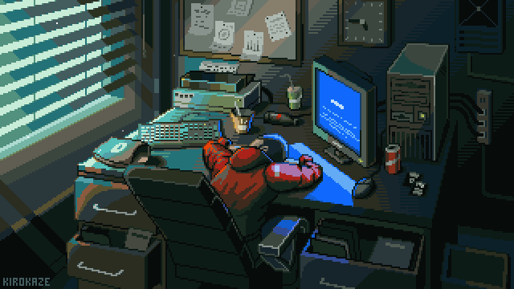
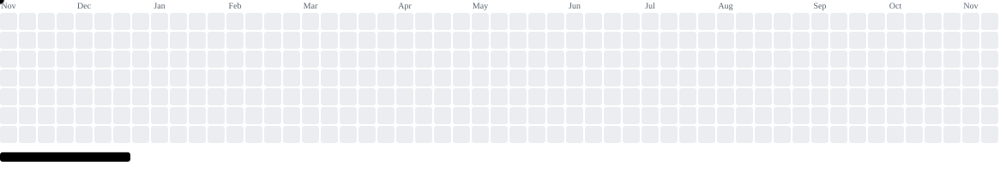

<h1 align="center">
  Hey  I'm Bramha Bajannavar
</h1>

  

## About Me

- Computer Science undergraduate at BMS College of Engineering.
- Interested in backend engineering, distributed systems, and applied AI/ML.
- Enjoy building projects that combine software engineering with practical problem-solving.

## Featured Projects

  

## Languages & Technologies

### Programming Languages

  
  
  
  
  

### Databases

  
  
  
  
  

### DevOps & Cloud

  
  
  
  

### Frontend

  
  
  
  
  

### Backend

  
  

### Tools

  
  
  

## GitHub Statistics

  
  

  

## Contribution Graph

  <picture>
    <source
      media="(prefers-color-scheme: dark)"
      srcset="https://raw.githubusercontent.com/bramhaaa/bramhaaa/output/breakout-contribution-graph-dark.svg"
    />
    <source
      media="(prefers-color-scheme: light)"
      srcset="https://raw.githubusercontent.com/bramhaaa/bramhaaa/output/breakout-contribution-graph.svg"
    />
    
  </picture>

## Connect With Me

  
  
  
  

  Building, learning, and shipping.

